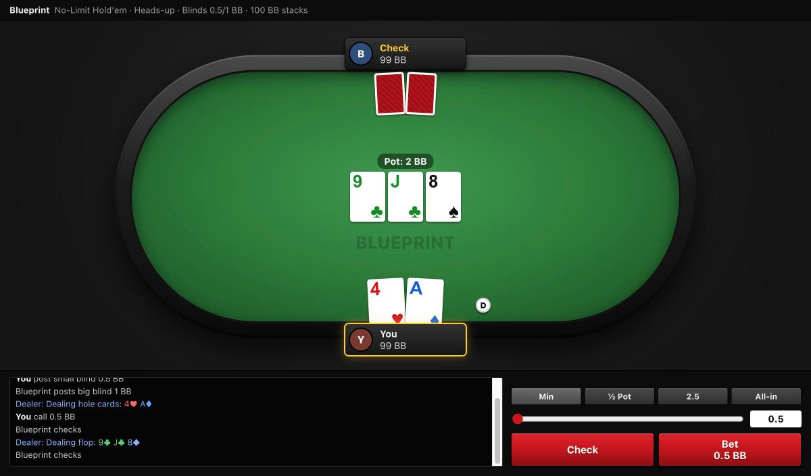
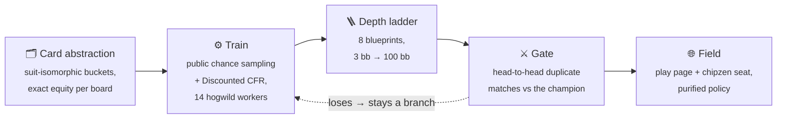
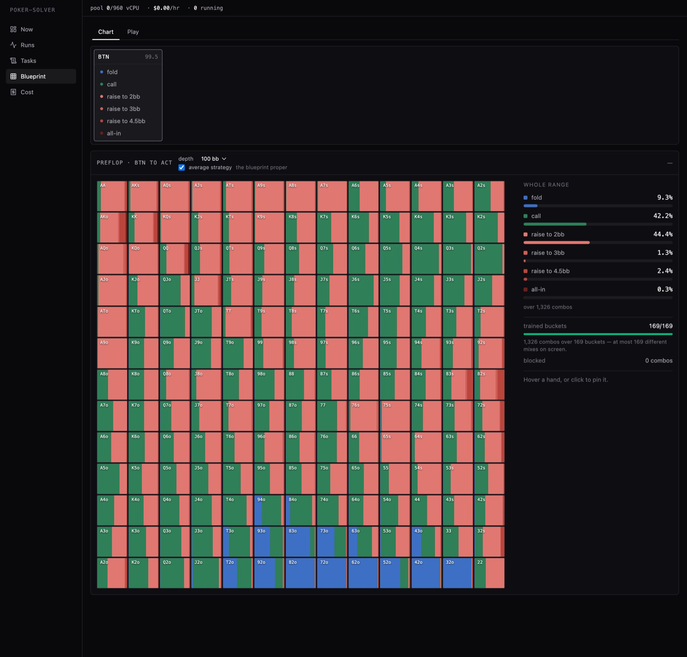
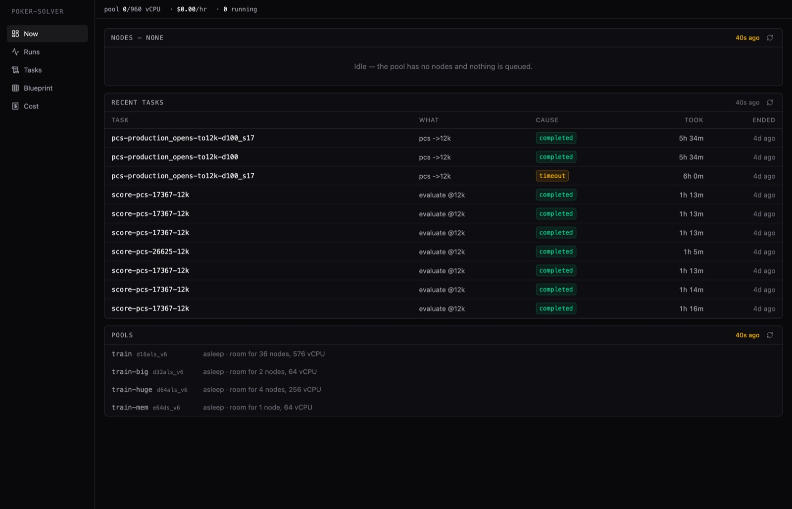
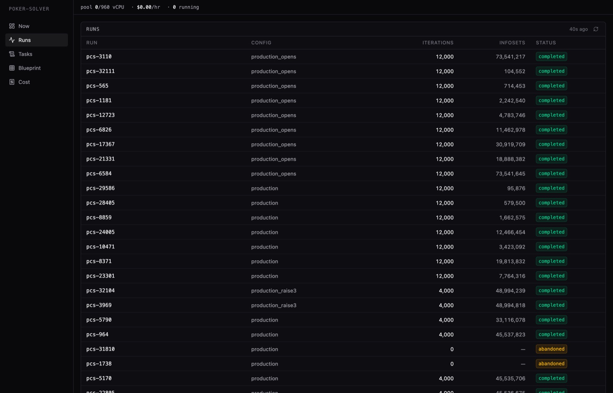

<div align="center">

# ♠️ Poker Solver

**A heads-up No-Limit Hold'em bot trained by counterfactual regret minimisation,<br>
on an autoscaling Azure Batch pool. It plays live.**

[](https://poker.matteopsnt.dev/)

[](https://github.com/matteo-psnt/poker-solver/actions/workflows/ci.yml)
[](https://www.python.org/downloads/)
[](https://docs.astral.sh/uv/)
[](https://github.com/astral-sh/ruff)
[](infra/)
[](LICENSE)

<a href="https://poker.matteopsnt.dev/">
  
</a>

**[Play it in your browser →](https://poker.matteopsnt.dev/)**

</div>

---

## Live

| | Where | What is behind it |
|---|---|---|
| 🃏 **Play the bot** | [poker.matteopsnt.dev](https://poker.matteopsnt.dev/) | The deepest blueprint (100 bb), served by `blueprint-serve` behind Caddy. The public route redacts the strategy mix and the bot's mucked cards. |
| 📈 **Strategy chart** | [poker.matteopsnt.dev/chart](https://poker.matteopsnt.dev/chart) | The same blueprints read as a 13×13 grid at any spot in the tree, every stack depth the seat fields. |
| 🤖 **Ranked seat** | [chipzen.ai](https://chipzen.ai) | `chipzen-seat` plays a ladder of **eight blueprints trained at different stack depths (3 → 100 bb)**, around the clock on a systemd unit with a watchdog. |
| 📊 **Console** | `just console` → `localhost:8765` | The operator's view of the pool, runs, tasks, blueprints and spend. It reads the record and is not public. |

## How it works



- **Card abstraction.** Boards and hands are canonicalised by suit isomorphism
  (22,100 flops → 1,755), every hand class gets its exact equity on every
  canonical board, and a weighted 1-D k-means buckets them per street. A♠K♠ on
  T♠9♠8♣ lands in a different bucket from A♠K♠ on T♥9♥8♣.
  [More →](src/pipeline/abstraction/postflop/README.md)
- **Trainer.** Public chance sampling (PCS) deals one public board per
  iteration and updates every private hand at once, with four runouts sharing a
  flop and turn. Regrets use Discounted CFR. Workers write lock-free into shared
  memory (hogwild).
- **Depth ladder.** One blueprint per effective stack depth. At the table the
  seat snaps *up* to the next deeper rung when it is within 2×.
- **Serving.** The seat plays a *purified* policy: actions below a probability
  threshold (0.35 at 100/50 bb, 0.20 shallower) are dropped and the rest
  renormalised. Runtime subgame search exists in `src/engine/search/` but is
  **off**: measured, it did not pay for itself.
- **Evaluation.** Every candidate has to beat the fielded champion **on chips**
  (`score --method blueprint_match`), over thousands of duplicate deals with
  paired standard errors. Exploitability (`exact_br`) is still recorded. It no
  longer selects anything, because it rewards folding.
  [Methodology →](src/pipeline/evaluation/README.md)

## The console



<sub><b>Blueprint</b>: the button opens to 2bb, the big blind 3-bets to 7bb, and the grid shows how the button answers with each starting hand: fold, call, 4-bet or all-in.</sub>

<table>
<tr>
<td width="50%"></td>
<td width="50%"></td>
</tr>
<tr>
<td align="center"><sub><b>Now</b>: the pool, its node sizes, and what just ran</sub></td>
<td align="center"><sub><b>Runs</b>: every run in the record, with its config, iterations and infosets</sub></td>
</tr>
</table>

## Quick start

Play the trained 100 bb bot on your own machine. No cloud account needed: it
downloads the blueprint once (1.9 GB) and serves the play page locally.

```bash
git clone https://github.com/matteo-psnt/poker-solver.git
cd poker-solver
uv sync
just play           # then open http://127.0.0.1:8790
```

Without [`just`](https://github.com/casey/just): download
[`blueprint-100bb.tar`](https://github.com/matteo-psnt/poker-solver/releases/tag/v0.1.0),
untar it into an empty directory, and from there run
`uv run --project <clone> poker-solver blueprint-serve --runs-dir data/runs --run run-pcs-production_opens-to12k-d100-145201-6584 --at 65000`.

Run the tests with `uv sync --group dev && uv run pytest -m "not slow"`.
Training, precompute and evaluation run on an Azure Batch pool that scales to
zero and need the Terraform in `infra/`; `uv run poker-solver --help` lists
everything the CLI can do.

## Architecture

```
src/
├── interfaces/   commands/ (every subcommand), cli/ + web/ that render them,
│                 cloud/ dispatch, blueprint/ serving, chipzen/ seat
├── pipeline/     training, evaluation, abstraction, blueprint workflows
├── engine/       solver and search internals
├── core/         the poker domain: game state and actions
├── adapters/     Postgres; reachable from interfaces/ only
└── shared/       config, the stdlib-only cloud task wrapper, caches
console/          the web console (Vite + React)
infra/            Terraform for the pool and the serving box, plus the node entry point
config/           training and abstraction presets
tests/            mirrors src/
```

`interfaces → pipeline → engine → core` is a strict one-way layering, enforced
by [import-linter](.importlinter).

## License

MIT. See [LICENSE](LICENSE).

> This is a research project. The strategies are approximate equilibria of an
> abstracted game. Do not use them for real-money play.
