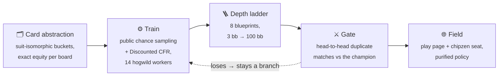

<div align="center">

# ♠️ Poker Solver

**A heads-up No-Limit Hold'em bot trained by counterfactual regret minimisation,<br>
on an autoscaling Azure Batch pool. It plays live.**

[](https://poker-blueprint.swedencentral.cloudapp.azure.com/)
[](https://chipzen.ai)

[](https://www.python.org/downloads/)
[](https://docs.astral.sh/uv/)
[](https://github.com/astral-sh/ruff)
[](infra/)
[](LICENSE)

<a href="https://poker-blueprint.swedencentral.cloudapp.azure.com/">
  
</a>

<sub>**[Play it in your browser →](https://poker-blueprint.swedencentral.cloudapp.azure.com/)**
No sign-up. 100 bb stacks, the button alternates, and stacks reset every hand.
Keys: <kbd>F</kbd> fold · <kbd>C</kbd> check/call · <kbd>R</kbd> bet/raise · <kbd>←</kbd><kbd>→</kbd> size · <kbd>Space</kbd> deal.</sub>

</div>

---

## Live

| | Where | What is behind it |
|---|---|---|
| 🃏 **Play the bot** | [poker-blueprint.swedencentral.cloudapp.azure.com](https://poker-blueprint.swedencentral.cloudapp.azure.com/) | The deepest blueprint (100 bb), served by `blueprint-serve` behind Caddy. The public route redacts the strategy mix and the bot's mucked cards. |
| 🤖 **Ranked seat** | [chipzen.ai](https://chipzen.ai) | `chipzen-seat` plays a ladder of **eight blueprints trained at different stack depths (3 → 100 bb)**, around the clock on a systemd unit with a watchdog. |
| 📊 **Console** | `just console` → `localhost:8765` | The operator's view of the pool, runs, tasks, blueprints and spend. It reads the record and is not public. |

## How it works



- **Card abstraction.** Boards and hands are canonicalised by suit isomorphism
  (22,100 flops → 1,755), every hand class gets its exact equity on every
  canonical board, and a weighted 1-D k-means buckets them per street. A♠K♠ on
  T♠9♠8♣ lands in a different bucket from A♠K♠ on T♥9♥8♣.
  [More →](src/pipeline/abstraction/postflop/README.md)
- **Trainer.** Public chance sampling (PCS) deals one public board per
  iteration and updates every private hand at once, with four runouts sharing a
  flop and turn. Regrets use Discounted CFR. Workers write lock-free into shared
  memory (hogwild).
- **Depth ladder.** One blueprint per effective stack depth. At the table the
  seat snaps *up* to the next deeper rung when it is within 2×.
- **Serving.** The seat plays a *purified* policy: actions below a probability
  threshold (0.35 at 100/50 bb, 0.20 shallower) are dropped and the rest
  renormalised. Runtime subgame search exists in `src/engine/search/` but is
  **off**: measured, it did not pay for itself.
- **Evaluation.** Every candidate has to beat the fielded champion **on chips**
  (`score --method blueprint_match`), over thousands of duplicate deals with
  paired standard errors. Exploitability (`exact_br`) is still recorded. It no
  longer selects anything, because it rewards folding.
  [Methodology →](src/pipeline/evaluation/README.md)

## What the experiments found

Each result is a paired head-to-head chip match on duplicate deals, in
milli-big-blinds per hand (mbb/hand, ± one standard error). It is measured
against a control that differs in that one change only.

| Change | Result | vs |
|---|---|---|
| Retrain the depth ladder on the current recipe | **+9.5 → +152.4** mbb/hand, monotone over 7 depths (3 → 50 bb) | the previously fielded ladder |
| New 100 bb rung (12,000 iterations, 14 workers) | **+26.0 ± 9.2** over 13 deal seeds | the previous 100 bb champion |
| Purify the policy at serve time | **+57.6 to +91.4** at 100 bb, **+65 to +87** at 50 bb | the raw mixed strategy |
| Train on 14 workers instead of 36 | **+193.9 ± 46** (4.2σ) | the same recipe on 36 workers |
| Drop the best-response opponent (CFR-BR) | won **11 of 12** arm-seed matches (sign test p = 0.0063) | CFR-BR arms that scored *better* on exploitability |

Most of these went *against* the exploitability bound, which is why the bound
was retired as a selection metric.

## The console

<table>
<tr>
<td width="50%"></td>
<td width="50%"></td>
</tr>
<tr>
<td align="center"><sub><b>Now</b>: the pool, its node sizes, and what just ran</sub></td>
<td align="center"><sub><b>Runs</b>: every run in the record, with its config, iterations and infosets</sub></td>
</tr>
</table>

The console is a Vite + React app over a thin server. Each endpoint makes one
`Command.invoke` call into the same commands as the CLI, so the two surfaces
can never disagree.

## Quick start

```bash
git clone https://github.com/matteo-psnt/poker-solver.git
cd poker-solver
uv sync --group dev
uv run poker-solver --help
```

There are **two surfaces, split by who is asking.** `poker-solver` is the
scriptable one: a cloud job, a shell or an agent drives it, and everything the
project can do is one of its flag-driven subcommands. The web console is the
one a human reads.

```bash
uv run poker-solver submit --config production --to 12000   # queue training on the pool
uv run poker-solver jobs                                    # what is running
uv run poker-solver score --run <id> --at 12000 \
    --method blueprint_match --vs <champion> -- --deals 20000  # head-to-head gate
uv run poker-solver ledger                                  # every evaluation, from the record

just console        # build the console and serve it on :8765
just console-dev    # Vite on :5173 with hot reload
```

**Real work runs in the cloud.** Training, precompute and evaluation all go to
an Azure Batch pool that scales to zero (`just create` provisions it with
Terraform). The laptop submits and reads. Iteration targets are **absolute**,
so re-submitting the same target is a no-op, and
`submit --run <id> --to <more>` continues a run on its recorded config.

<details>
<summary><b>Where things live</b></summary>

There is no `data/` directory, and nothing recreates one.

| What | Where |
|---|---|
| Checkpoint rungs and manifest | the `checkpoints` blob container |
| Run, task and evaluation record | Postgres (`src/adapters/`) |
| Logs and profiles | the `diagnostics` blob container |
| Regenerable caches | `$POKER_SOLVER_CACHE`, else `$XDG_CACHE_HOME`, else `~/.cache/poker-solver` |
| Training recipes | `config/training/*.yaml`, sparse overrides on `src/shared/config/schema.py` |

</details>

## Architecture

```
src/
├── interfaces/   commands/ (every subcommand), cli/ + web/ that render them,
│                 cloud/ dispatch, blueprint/ serving, chipzen/ seat
├── pipeline/     training, evaluation, abstraction, blueprint workflows
├── engine/       solver and search internals
├── core/         the poker domain: game state and actions
├── adapters/     Postgres; reachable from interfaces/ only
└── shared/       config, the stdlib-only cloud task wrapper, caches
console/          the web console (Vite + React)
infra/            Terraform for the pool and the serving box, plus the node entry point
config/           training and abstraction presets
tests/            mirrors src/
```

`interfaces → pipeline → engine → core` is a strict one-way layering.
[import-linter](https://github.com/seddonym/import-linter) enforces it with
eleven contracts, and [`.importlinter`](.importlinter) is the documentation.

## Development

```bash
uv run pytest -m "not slow"           # fast gate (parallel via -n auto)
uv run pytest                         # full suite
uv run pre-commit run --all-files     # ruff, ty, import-linter, deptry, vulture
```

## License

MIT. See [LICENSE](LICENSE).

> This is a research project. The strategies are approximate equilibria of an
> abstracted game. Do not use them for real-money play.
